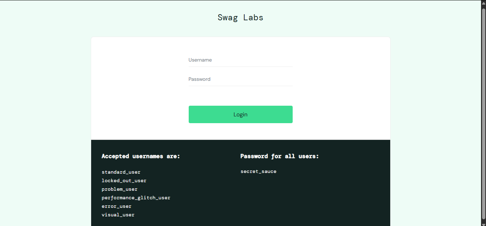
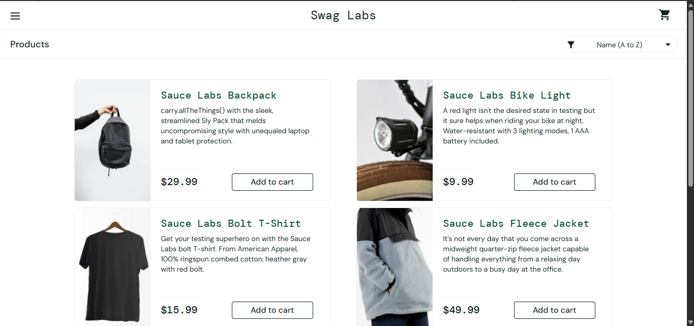

# SD-BUG-001 — Keyboard Focus Indicator Not Clearly Visible

## Summary

The keyboard-focus indicator is not clearly distinguishable on the Login button and product sorting dropdown when navigating with the Tab key.

## Environment

- Application: https://www.saucedemo.com/
- Browser: Microsoft Edge 154.0.4258.53
- Operating system: Windows 11
- Viewport: 1366 × 639

## Related Test Case

- Test Case ID: SD-TC-UX-01
- Execution result: Fail

## Preconditions

- The SauceDemo login page is open.
- For the inventory-page check, the user is logged in.

## Steps to Reproduce

1. Open the SauceDemo login page.
2. Navigate through interactive elements using the Tab key.
3. Move keyboard focus to the Login button.
4. Observe whether the focused state is visually distinguishable.
5. Log in and repeat the keyboard navigation check on the product sorting dropdown.

## Expected Result

The currently focused interactive control should have a visible, distinguishable focus indicator so keyboard users can identify which control will receive their next action.

## Actual Result

Most interactive elements displayed a visible focus indicator. However, the Login button and product sorting dropdown did not appear to have clearly distinguishable focus indicators. The issue was reproduced during retesting.

## User Impact

Keyboard users may have difficulty identifying their current position on the page and determining which control will be activated.

## Severity and Priority

- Severity: Pending assessment against the project's severity criteria.
- Priority: Pending triage.

## Status

Open — reproducible. Screenshot evidence is attached below.

## Evidence

### Login button focus

### Product sorting dropdown focus

### Related manual execution log

[Manual test execution log](../manual-testing/execution-log.md)
## Notes

This report describes the observed behaviour. It does not claim that a complete accessibility-standard assessment has been performed.

